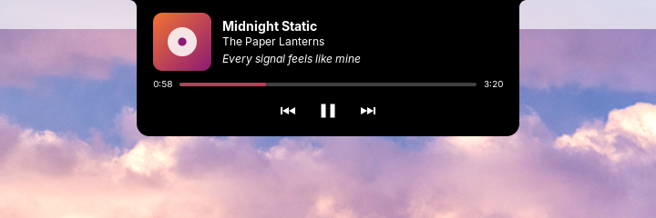

# Nokta

A MacBook-style notch for the Linux desktop. A black notch sits on the top
edge of the screen and shows the song that is playing. Hover over it and it
opens with the cover, controls, a seek bar and the current line of the
song's synced lyrics.




Nokta has two parts:

- **`noktad`**, a small Rust daemon that follows your media players (MPRIS),
  fetches lyrics and reads your settings.
- **A GNOME Shell extension** that draws the notch and talks to the daemon
  over D-Bus.

The daemon does the work so the shell stays fast. It uses no CPU while
nothing plays and about 10 MB of memory.

## Requirements

- GNOME Shell 46 (Ubuntu 24.04, Zorin OS 18, Fedora 40 and others). Other
  versions are not supported yet.
- An x86_64 machine for the prebuilt daemon. On other architectures,
  [build from source](#build-from-source).
- A music player that supports MPRIS. Spotify, Rhythmbox, Lollypop, VLC,
  mpv (with `mpv-mpris`), Firefox and Chromium all do.

## Install

1. Download `noktad-<version>-x86_64-linux.tar.gz` from the
   [latest release](https://github.com/MasRama/nokta/releases/latest).
2. Unpack it and run the installer:

   ```sh
   tar xf noktad-*-x86_64-linux.tar.gz
   cd noktad-*-x86_64-linux
   ./install.sh
   ```

   It installs into your home directory only and never uses `sudo`:
   `~/.local/bin/noktad`, a systemd user unit, a D-Bus activation file and
   the GNOME extension.
3. Log out and log back in. GNOME on Wayland loads new extensions only at
   login.
4. Turn the extension on:

   ```sh
   gnome-extensions enable nokta@nokta.io
   ```

The daemon starts by itself the first time the extension needs it.

**Just Perfection users:** Nokta normally moves the GNOME clock to the right
side of the top bar so the notch does not cover it. When Just Perfection is
enabled, Nokta leaves the clock alone so the two extensions don't fight over
it. Open Just Perfection's settings and set **Clock Menu Position** to
**Right** instead.

## Settings

Settings live in `~/.config/nokta/config.toml`. The daemon writes a commented
copy with the defaults on first start. Changes apply as soon as you save the
file. If the file has a mistake, Nokta keeps the last working settings and
logs the line and column of the error (`journalctl --user -u nokta`).

### `[appearance]`

| Key | Default | What it does |
|---|---|---|
| `height` | `32` | Height of the closed notch in pixels |
| `idle_width` | `180` | Width of the closed notch when nothing plays |
| `playing_width` | `260` | Width of the closed notch while music plays |
| `expanded_width` | `420` | Width of the open notch |
| `expanded_height` | `150` | Height of the open notch |
| `corner_radius` | `14` | Radius of the bottom corners |
| `ear_radius` | `8` | Radius of the inward curves where the notch meets the top edge |
| `background` | `"#000000"` | Notch color |
| `foreground` | `"#ffffff"` | Text and icon color |
| `use_album_accent` | `true` | Color the seek bar and the equalizer with the cover's color |
| `animation_speed` | `1.0` | `0.5` is twice as fast, `2.0` twice as slow |

### `[behavior]`

| Key | Default | What it does |
|---|---|---|
| `open_delay_ms` | `120` | How long the pointer must rest on the notch before it opens |
| `close_delay_ms` | `300` | How long the notch stays open after the pointer leaves |
| `move_clock` | `true` | Move the GNOME clock to the right side of the top bar |
| `show_lyrics` | `true` | Show the current lyric line in the open notch |

### `[lyrics]`

| Key | Default | What it does |
|---|---|---|
| `enabled` | `true` | Look up lyrics on lrclib.net |

## Privacy

To find lyrics, `noktad` sends the artist, title, album and length of the
song that is playing to [LRCLIB](https://lrclib.net), a free, open lyrics
database. It sends nothing else, and nothing at all when lyrics are turned
off:

```toml
[lyrics]
enabled = false
```

Cover art that a player offers as a web address is downloaded to
`~/.cache/nokta/art/`. Lyrics are cached in `~/.cache/nokta/lyrics/`.

## Uninstall

From the unpacked release folder:

```sh
./uninstall.sh          # keeps ~/.config/nokta and ~/.cache/nokta
./uninstall.sh --purge  # removes them too
```

## Build from source

You need Rust (stable), Node.js 22.13 or newer, and `gnome-extensions`
(part of GNOME Shell).

```sh
git clone https://github.com/MasRama/nokta.git
cd nokta
cargo build --release
(cd extension && npm ci && npm run pack)
packaging/install.sh
gnome-extensions install --force build/nokta@nokta.io.shell-extension.zip
```

`install.sh` finds the binary in `target/release` when it runs from a
checkout. Then log out, log back in and enable the extension as above.
`docs/testing.md` shows how to try changes in a throwaway GNOME Shell
without touching your session.

## Troubleshooting

- **The notch shows only a clock while music plays.** Check that the daemon
  runs: `systemctl --user status nokta`. Its log is in
  `journalctl --user -u nokta`.
- **No lyrics.** LRCLIB does not know every song, and only time-synced lyrics
  are shown. A song that was not found is not looked up again for 7 days.
- **The extension does not show up in `gnome-extensions list`.** Log out and
  back in after installing.

## Contributing

Bug reports and pull requests are welcome. Read
[CONTRIBUTING.md](CONTRIBUTING.md) first, and
[ARCHITECTURE.md](ARCHITECTURE.md) for how the pieces fit together.

## License

[GPL-3.0-or-later](LICENSE)
