# Nokta

An open-source dynamic island for the desktop. A small black notch sits on
the top edge of the screen. It shows the song that is playing with its
lyrics, the volume, your earbuds' battery, a focus timer and your
notifications. Hover over it to open it.

<p align="center">
  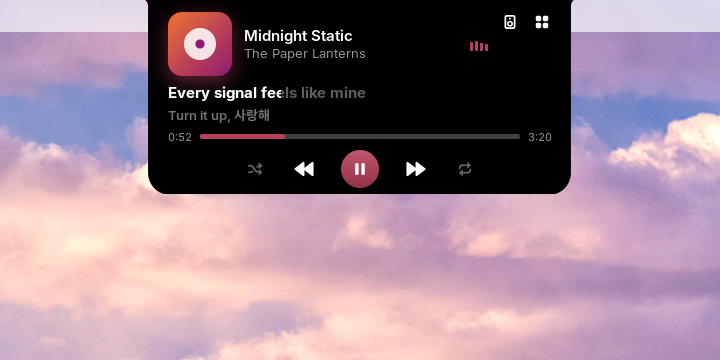
  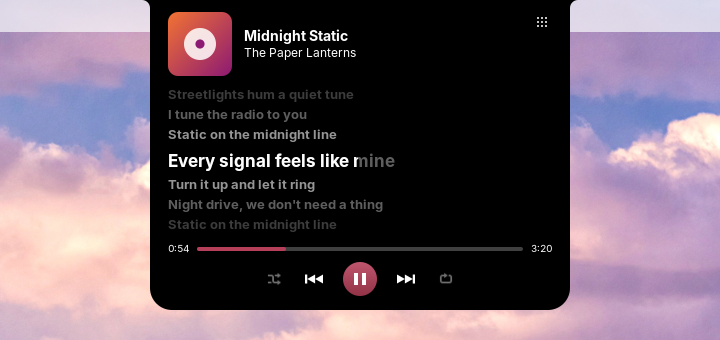
</p>
<p align="center">
  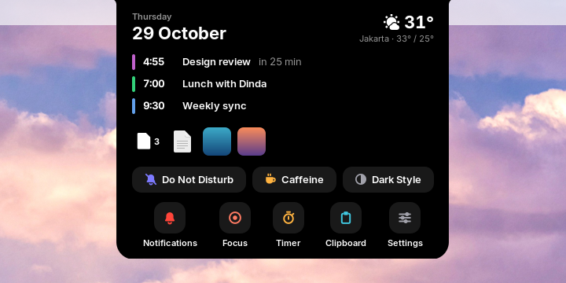
  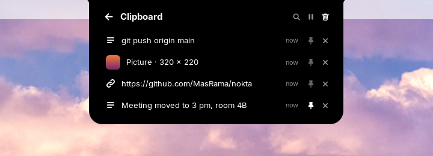
</p>
<p align="center">
  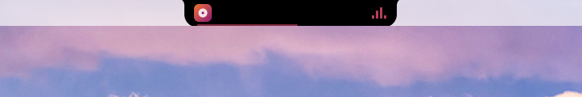
  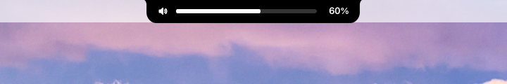
</p>
<p align="center">
  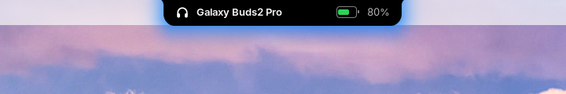
  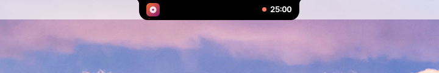
</p>
<p align="center">
  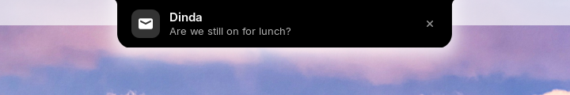
  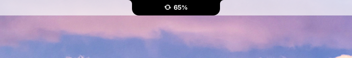
</p>
<p align="center">
  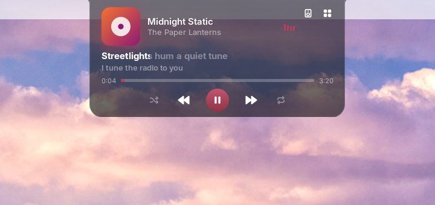
  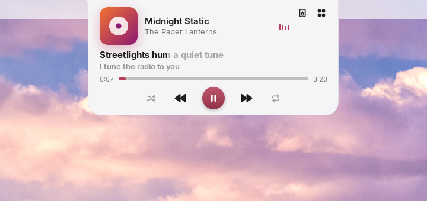
</p>

## Features

- **Music.** The cover, play controls, a seek bar, and shuffle and repeat
  when the player has them. With several players open, the arrows under the
  title (or scrolling over the cover) switch between them.
- **Synced lyrics, karaoke style.** The line being sung lights up from left
  to right, with the next line under it. Click it to follow the lyrics
  around it. Lyrics come from [LRCLIB](https://lrclib.net), or from your
  own `.lrc` files.
- **System popups.** Volume, brightness, the microphone, Caps Lock, Num
  Lock and the keyboard layout show in the notch instead of GNOME's popup.
  A muted speaker or microphone says so.
- **Devices.** The notch tells you when Bluetooth headphones connect (with
  their battery), when the charger is plugged in or out, and when the
  battery is low or full.
- **Home.** When nothing plays, hovering opens home: the date and the
  weather (see [Settings](#settings)), the next event from GNOME's calendar, running
  activities, the files on the shelf, quick toggles for Do Not Disturb,
  Caffeine (the screen stays on) and the dark style, and tiles for the
  notification list, focus, the clipboard and Settings. While a song plays,
  the grid button at the player's top right opens it.
- **Notifications** show in the notch instead of GNOME's banner. Hover to
  keep one open, click it to open the app.
- **Focus timer.** Start it from Quick Settings or with
  <kbd>Super</kbd>+<kbd>Alt</kbd>+<kbd>F</kbd>. It counts down in the notch
  and starts a break when the session ends.
- **[Live activities](#live-activities).** A build, a download or a backup
  shows in the notch while it runs, and then says how it ended.
- **[File shelf](#file-shelf).** Drop files on the notch to keep them
  there, then drag them into another app.
- **[Screenshots](#screenshots).** After a screenshot, the notch shows it
  with buttons to open it, show it in Files or keep it on the shelf.
- **[Clipboard history](#clipboard-history).** What you copy, text and
  pictures, ready to copy again from home.
- **Privacy dots.** A green dot while an app uses the camera, an orange
  one for the microphone or screen sharing.
- **Themes.** Midnight, graphite, glass, aurora (tinted with the cover's
  color) and paper, or your own colors.
- **Every monitor** has its own notch, and alerts show on the one you are
  working on.

## Install

You need:

- GNOME Shell 46 to 51: Ubuntu 24.04 and 26.04, Zorin OS 18, Debian 13,
  Fedora 43 to 45, RHEL and AlmaLinux 10, Arch and others. GNOME 45 and
  older are not supported.
- An x86_64 machine for the prebuilt daemon. On other architectures,
  [build from source](#build-from-source).
- A music player that supports MPRIS. Spotify, Rhythmbox, Lollypop, VLC,
  mpv (with `mpv-mpris`), Firefox and Chromium all do.

Then:

1. Download `noktad-<version>-x86_64-linux.tar.gz` from the
   [latest release](https://github.com/MasRama/nokta/releases/latest).
2. Unpack it and run the installer:

   ```sh
   tar xf noktad-*-x86_64-linux.tar.gz
   cd noktad-*-x86_64-linux
   ./install.sh
   ```

   It installs into your home directory only and never uses `sudo`:
   `~/.local/bin/noktad`, the `~/.local/bin/nokta` command, a systemd user
   unit, a D-Bus activation file and the GNOME extension.
3. Log out and log back in. GNOME on Wayland loads new extensions only at
   login.
4. Turn the extension on:

   ```sh
   gnome-extensions enable nokta@nokta.io
   ```

The daemon starts by itself the first time the extension needs it. To
update, do the same with the new release.

**Just Perfection users:** Nokta moves the GNOME clock to the right side of
the top bar so the notch does not cover it. When Just Perfection is
enabled, Nokta leaves the clock alone so the two don't fight over it. Set
Just Perfection's **Clock Menu Position** to **Right** instead.

## Using Nokta

### Live activities

Any program can show what it is doing in the notch. The `nokta` command
makes it a one-liner for scripts:

```sh
nokta run -- cargo build --release          # shows "cargo build" while it runs, then ✓ or ✗
nokta activity set backup --title "Backup" --detail "Photos" --progress 40
nokta activity end backup --message "1 204 files"
nokta activity end backup --failed --message "Disk full"
```

`nokta run` passes the command's exit code through, and the command still
runs when Nokta does not. `nokta --help` lists every option. Programs can
also call `io.nokta.Activities1` on the session bus (see
[ARCHITECTURE.md](ARCHITECTURE.md)). The newest activity shows in the
closed notch, with its percentage when it reports one. Hover to see up to
three.

### File shelf

Drag files from Files, a browser or any other app to the notch. It opens
with `Drop to keep here`, and the files you drop stay on its shelf. The
closed notch shows how many there are. The open notch lists them, newest
first, after a stack that holds them all; pictures show a thumbnail.

Drag a file (or the stack, for all of them) into another app, for example a
chat, to send it. It leaves the shelf once the app takes it. Click a file
to open it, or its `×` to take it off. The shelf keeps up to 30 files,
forgets one that is moved or deleted, and is empty again after you log out.
Nokta never copies the files.

GNOME Shell cannot take a drop from an app, so the extension starts a small
helper window (`gjs`, a GTK 4 window that draws nothing) under the notch
while you drag. It is not in Alt+Tab or the overview.

### Screenshots

After a screenshot, the notch shows it instead of GNOME's `Screenshot
captured` banner, with `Open`, `Show in Files` and `Keep on shelf`. A click
on the picture opens it too. `Keep on shelf` puts the file on the
[file shelf](#file-shelf), ready to drag into a chat.

The preview shows only for screenshots taken with the screenshot UI (Print
Screen): GNOME does not say which file the direct shortcuts
(Shift+Print Screen, Alt+Print Screen) saved. With saving to disk turned
off in GNOME, the preview has no buttons.

### Clipboard history

The `Clipboard` tile in home opens what you copied, newest first: text with
its first line, pictures with a thumbnail. Click an entry to copy it again,
ready to paste. Its pin keeps it when the history is full or cleared, and
its `×` takes it out. Scroll over the list for older entries.

The buttons in the header pause the history (copies are not kept until you
resume) and clear it. The notch's right-click menu has `Pause clipboard`
too. Nokta skips what a password manager marks as secret, and pictures
larger than 8 MB. The history is kept in memory only, so it is empty again
after you log out.

## Settings

Open the settings window from the Settings tile in home, from the menu a
right click on the notch opens, with `nokta settings`, or from the
Extensions app. A change shows in the notch right away.

The window saves to `~/.config/nokta/config.toml`. You can edit that file
by hand too, and your comments are kept either way. The daemon writes a
commented copy with the defaults on first start, and applies changes as
soon as you save. If the file has a mistake, Nokta keeps the last working
settings and logs the line and column of the error
(`journalctl --user -u nokta`); the window says what to fix before it saves
anything.

Every key, by table:

<details>
<summary><code>[appearance]</code>: theme, colors and sizes</summary>

| Key | Default | What it does |
|---|---|---|
| `theme` | `"midnight"` | `"midnight"` (black), `"graphite"` (dark grey with a fine edge), `"glass"` (see-through), `"aurora"` (tinted with the cover's color), `"paper"` (light), or `"custom"` for the four colors below |
| `height` | `32` | Height of the closed notch in pixels |
| `idle_width` | `180` | Width of the closed notch when nothing plays |
| `playing_width` | `260` | Width of the closed notch while music plays |
| `expanded_width` | `420` | Width of the open notch |
| `expanded_height` | `150` | Height of the open notch |
| `corner_radius` | `14` | Radius of the bottom corners |
| `ear_radius` | `8` | Radius of the inward curves where the notch meets the top edge |
| `background` | `"#000000"` | Notch color, with `theme = "custom"` |
| `background_opacity` | `1.0` | `0.0` makes the notch background see-through, `1.0` solid; text and icons stay solid; with `theme = "custom"` |
| `foreground` | `"#ffffff"` | Text and icon color, with `theme = "custom"` |
| `accent` | `"#ffffff"` | Color of the seek bar, the play button, the equalizer and the volume bar when the cover's color is not used, with `theme = "custom"` |
| `use_album_accent` | `true` | Color the seek bar, the play button and the equalizer with the cover's color, in every theme |
| `animation_speed` | `1.0` | `0.5` is twice as fast, `2.0` twice as slow |
| `osd_width` | `300` | Width of the notch while it shows volume, brightness or Caps Lock |

</details>

<details>
<summary><code>[behavior]</code>: what the notch shows and when</summary>

| Key | Default | What it does |
|---|---|---|
| `open_delay_ms` | `120` | How long the pointer must rest on the notch before it opens |
| `close_delay_ms` | `300` | How long the notch stays open after the pointer leaves |
| `move_clock` | `true` | Move the GNOME clock to the right side of the top bar |
| `show_lyrics` | `true` | Show the current lyric line in the open notch |
| `replace_osd` | `true` | Show volume, brightness and other system popups in the notch instead of GNOME's popup |
| `osd_duration_ms` | `1500` | How long the notch shows the volume or brightness after the last change |
| `show_caps_lock` | `true` | Show a message in the notch when Caps Lock turns on or off |
| `show_num_lock` | `false` | Show a message in the notch when Num Lock turns on or off |
| `show_input_source` | `true` | Show the new keyboard layout when you switch layouts |
| `all_monitors` | `true` | Show a notch on every monitor; `false` shows it only on the primary monitor |
| `device_alerts` | `true` | Show Bluetooth audio, charger and battery alerts in the notch |
| `alert_duration_ms` | `3000` | How long a device alert stays |
| `show_clock` | `true` | Show the time in the notch while nothing plays |
| `clock_format` | `"system"` | `"24h"` (17:00), `"12h"` (5:00), or `"system"` to follow GNOME's setting |
| `privacy_dots` | `true` | A green dot while the camera is on and an orange one while the microphone or screen sharing is in use |
| `live_activities` | `true` | Show live activities in the notch; `false` shows none, and scripts that report them keep working |
| `file_shelf` | `true` | Drop files on the notch to park them, then drag them out again (see [File shelf](#file-shelf)) |
| `screenshot_preview` | `true` | After a screenshot, a preview with `Open`, `Show in Files` and `Keep on shelf` instead of its banner (see [Screenshots](#screenshots)); needs `[notifications] in_notch` |

</details>

<details>
<summary><code>[lyrics]</code>: looking lyrics up</summary>

| Key | Default | What it does |
|---|---|---|
| `enabled` | `true` | Look up lyrics on lrclib.net |

</details>

<details>
<summary><code>[timer]</code>: the focus timer</summary>

Start the timer with the **Focus** toggle in Quick Settings or with
<kbd>Super</kbd>+<kbd>Alt</kbd>+<kbd>F</kbd>; the same keys stop it. The
toggle's menu also starts a break, pauses and stops. After every few focus
sessions the break is a long one; stopping the timer starts the count
again. The timer runs in the daemon, so it keeps going while the screen is
locked.

| Key | Default | What it does |
|---|---|---|
| `focus_minutes` | `25` | Length of a focus session, 1 to 180 |
| `break_minutes` | `5` | Break that starts after a focus session, 0 to 60; `0` means no break |
| `long_break_minutes` | `15` | Long break, 1 to 60 |
| `sessions_before_long_break` | `4` | Focus sessions before a long break, 0 to 12; `0` means never |
| `sound` | `true` | Play a sound when a focus session or a break ends |
| `quiet_notifications` | `true` | Show no notification banners while a focus session runs; they still go to the message list. Banners you had turned off stay off |
| `shortcut` | `"<Super><Alt>f"` | Keys that start focus or stop the timer, written like GNOME's keyboard shortcuts (`<Control><Shift>F12`); `""` means no shortcut |

</details>

<details>
<summary><code>[activities]</code>: live activities</summary>

| Key | Default | What it does |
|---|---|---|
| `stale_minutes` | `30` | An activity not updated for this long ends as failed, 1 to 1440 |

</details>

<details>
<summary><code>[weather]</code>: the weather in home</summary>

Set a location and home shows the weather beside the date: the sky, the
temperature, and the place with today's high and low. It comes from
[Open-Meteo](https://open-meteo.com), which needs no account. `noktad`
asks again when the notch opens and the reading is more than 30 minutes
old, or 5 minutes after a failed request.

| Key | Default | What it does |
|---|---|---|
| `enabled` | `true` | Show the weather when a location is set |
| `location` | `""` | A place like `"Jakarta"`, or coordinates like `"-6.2,106.8"`; `""` shows no weather |
| `units` | `"celsius"` | `"celsius"` or `"fahrenheit"` |

</details>

<details>
<summary><code>[calendar]</code>: the next event and its reminder</summary>

Home shows the next event from GNOME's calendar (the same events as the
date menu, including online accounts), with its time and how soon. A click
opens your calendar app. Before it starts the notch says `Standup in 5
min`, and at the start `Standup is starting`. All-day events are left out.

| Key | Default | What it does |
|---|---|---|
| `enabled` | `true` | Show the next event and its reminders |
| `reminder_minutes` | `5` | How long before an event to show it, 0 to 60; `0` shows only the start |

</details>

<details>
<summary><code>[notifications]</code>: notifications in the notch</summary>

| Key | Default | What it does |
|---|---|---|
| `in_notch` | `true` | Show the notifications GNOME would show as a banner in the notch instead. Critical ones, and any while an app is fullscreen, still use GNOME's banner. Do Not Disturb and each app's notification settings still apply |
| `duration_ms` | `5000` | How long a notification stays, 1000 to 30000; it stays while the pointer is on it |
| `show_body` | `true` | Show the message; `false` shows only the title and the app |

</details>

<details>
<summary><code>[clipboard]</code>: the clipboard history</summary>

| Key | Default | What it does |
|---|---|---|
| `enabled` | `true` | Keep a history of what you copy. Turning it off forgets the whole history, pinned entries too |
| `max_items` | `25` | How many entries to keep, 5 to 100, besides the pinned ones |

</details>

## Privacy

- **Lyrics.** To find lyrics, `noktad` sends the artist, title, album and
  length of the song that is playing to [LRCLIB](https://lrclib.net), a
  free, open lyrics database. It sends nothing else, and nothing at all
  with `[lyrics] enabled = false`.
- **Weather.** `noktad` sends the location you set to
  [Open-Meteo](https://open-meteo.com): a place name to find its
  coordinates, then the coordinates for the forecast. With
  `location = ""`, the default, it sends nothing.
- **Clipboard.** The history never leaves your computer and is never
  written to disk, except small thumbnails of copied pictures in
  `$XDG_RUNTIME_DIR/nokta/clipboard/` (memory, readable only by you,
  emptied when `noktad` starts and when an entry goes).
- **Caches.** Cover art that a player offers as a web address is
  downloaded to `~/.cache/nokta/art/`. Lyrics are cached in
  `~/.cache/nokta/lyrics/`.

## Troubleshooting

- **The notch shows only a clock while music plays.** Check that the daemon
  runs: `systemctl --user status nokta`. Its log is in
  `journalctl --user -u nokta`.
- **No lyrics.** LRCLIB does not know every song, and only time-synced
  lyrics are shown. A song that was not found is not looked up again for 7
  days. Songs played on YouTube in a browser work too: Nokta drops
  "(Official Music Video)" and the like and reads the artist from the
  title.
- **Your own lyrics.** Put a synced `.lrc` file next to a local music file
  with the same name (`Song.flac` and `Song.lrc`), or name it
  `Artist - Title.lrc` and put it in `~/.local/share/nokta/lyrics/`. Your
  files always win over LRCLIB and show the next time the song plays.
- **The extension does not show up in `gnome-extensions list`.** Log out and
  back in after installing.

## Uninstall

From the unpacked release folder:

```sh
./uninstall.sh          # keeps ~/.config/nokta and ~/.cache/nokta
./uninstall.sh --purge  # removes them too
```

## Build from source

You need Rust (stable), Node.js 22.13 or newer, and `gnome-extensions`
(part of GNOME Shell).

```sh
git clone https://github.com/MasRama/nokta.git
cd nokta
cargo build --release
(cd extension && npm ci && npm run pack)
packaging/install.sh
gnome-extensions install --force build/nokta@nokta.io.shell-extension.zip
```

`install.sh` finds the binary in `target/release` when it runs from a
checkout. Then log out, log back in and enable the extension as above.
[docs/testing.md](docs/testing.md) shows how to try changes in a throwaway
GNOME Shell without touching your session.

## How it works

Nokta has two parts:

- **`noktad`**, a small Rust daemon. It follows your media players (MPRIS),
  fetches lyrics and the weather, watches the battery (UPower) and
  Bluetooth (BlueZ), runs the focus timer, keeps the shelf and the
  clipboard history, and reads your settings.
- **A frontend** that draws the notch and talks to the daemon. On Linux it
  is a GNOME Shell extension, and they talk over D-Bus.

The daemon does the work so the shell stays fast. It uses no CPU while
nothing plays and about 10 MB of memory.
[ARCHITECTURE.md](ARCHITECTURE.md) has the details.

| Platform | Status |
|---|---|
| Linux, GNOME 46 to 51 | Works (47 is untested: no supported distribution ships it) |
| Linux, KDE Plasma, Hyprland, Sway | Planned |
| Windows | Planned: the daemon's core builds and passes its tests there |
| macOS | Planned: the daemon's core builds and passes its tests there |

The plan is one daemon for every platform, with a small frontend for each
desktop that draws the notch. Today the only frontend, and the only media
and device sources, are on Linux. CI builds and tests the rest of the
daemon on macOS and Windows on every change.

## Contributing

Bug reports and pull requests are welcome. Read
[CONTRIBUTING.md](CONTRIBUTING.md) first, and
[ARCHITECTURE.md](ARCHITECTURE.md) for how the pieces fit together.
`tools/devshell/readme-shots.sh` takes the screenshots above again.

## License

[GPL-3.0-or-later](LICENSE)
