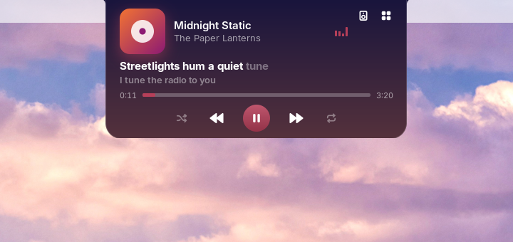
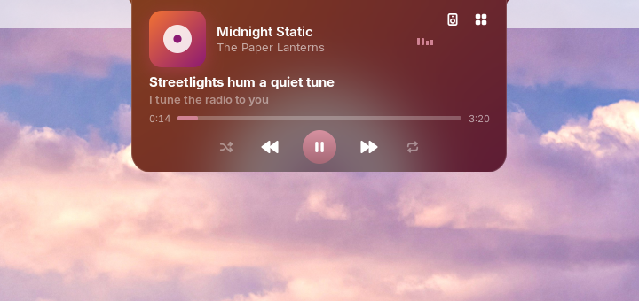
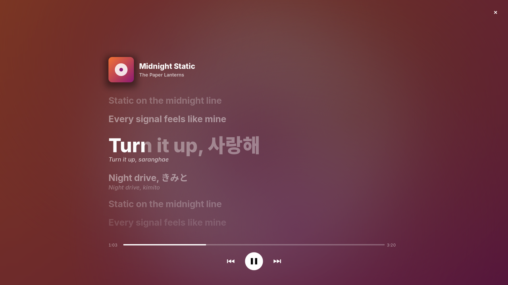
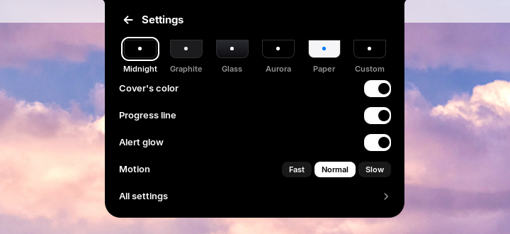
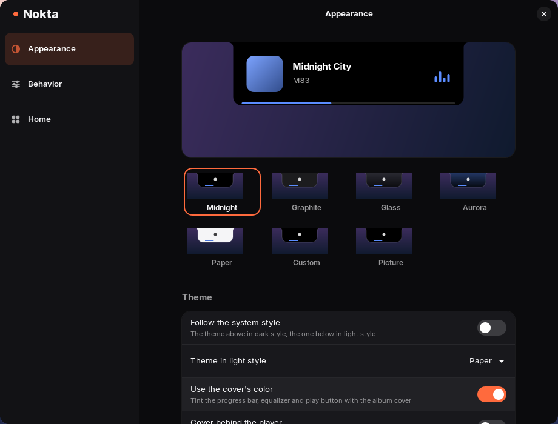

<h1>
  <picture>
    <source media="(prefers-color-scheme: dark)" srcset="docs/brand/nokta-logo-reverse.svg">
    
  </picture>
</h1>

A dynamic island for the desktop: one small notch at the top of your screen
for what's happening now, out of the way until you need it. Open source.
GNOME today, Windows and macOS next. Hover over it to open it, or press
<kbd>Super</kbd>+<kbd>Alt</kbd>+<kbd>N</kbd>.

<p align="center">
  
  
</p>
<p align="center">
  
  
</p>
<p align="center">
  
  
</p>
<p align="center">
  
  
</p>
<p align="center">
  
  
</p>
<p align="center">
  
  
</p>
<p align="center">
  
  
</p>
<p align="center">
  
</p>

## Features

- **Music.** The cover, play controls, a seek bar, and shuffle and repeat
  when the player has them. With several players open, the arrows under the
  title (or scrolling over the cover) switch between them. The speaker
  button at the player's top right switches the sound output, for example
  from the speakers to your headphones. With `[media] real_equalizer` on,
  the bars follow the music's bass, mids and highs instead of a pattern.
  When the song changes, the closed notch widens for 3 s with its title and
  artist; on pause the bars settle and the cover dims.
- **Synced lyrics, karaoke style.** The line being sung lights up from left
  to right, with the next line under it. Click it to follow the lyrics
  around it. Lyrics come from [LRCLIB](https://lrclib.net), or from your
  own `.lrc` files. When they run ahead of the song or behind it, the `−`
  and `+` under the lyrics view move them a quarter second later or
  earlier; Nokta remembers that for the song, and a click on the label
  between them puts it back. A Korean or Japanese line gets its
  pronunciation in Latin letters under it (사랑해 → saranghae, きって →
  kitte), worked out on your computer; kanji stay as they are. The
  button in the corner of the lyrics view puts them full screen, karaoke
  style: the cover, the title and the lines around the one being sung,
  over the cover's colors drifting slowly. Moving the pointer shows the
  seek bar and the play buttons; Space plays or pauses, and Escape, × or
  a click elsewhere closes it.
- **System popups.** Volume, brightness, the microphone, Caps Lock, Num
  Lock and the keyboard layout show in the notch instead of GNOME's popup.
  A muted speaker or microphone says so.
- **Devices.** The notch tells you when Bluetooth headphones connect (with
  their battery), when the charger is plugged in or out, and when the
  battery is low or full.
- **Home.** When nothing plays, hovering opens home: the date and the
  weather (see [Settings](#settings)), the next events from GNOME's calendar (a meeting gets a
  *Join* button), running
  activities, timers, the files on the shelf, quick toggles for Do Not Disturb,
  Caffeine (the screen stays on) and the dark style, and tiles for the
  notification list, focus, timers, the clipboard and Settings. While a song plays,
  the grid button at the player's top right opens it. Choose its toggles and
  tiles and their order on the settings window's Home page: Night Light and a
  Screenshot tile are there too.
- **Notifications** show in the notch instead of GNOME's banner. Hover to
  keep one open, click it to open the app. Its buttons (`Reply`,
  `Archive`, up to three) show in a row under it, and × closes it while
  it stays in GNOME's message list. A new one from the same app replaces
  it and counts on its icon (`2`, `3`, … `9+`). GNOME has no inline
  reply, so neither does the notch.
- **Focus timer.** Start it from Quick Settings or with
  <kbd>Super</kbd>+<kbd>Alt</kbd>+<kbd>F</kbd>. It counts down in the notch
  and starts a break when the session ends.
- **[Timers, stopwatches and alarms](#timers-stopwatches-and-alarms).**
  Start one from home or with `nokta timer 10m Tea`; it counts in the
  notch and rings when it is done.
- **[Live activities](#live-activities).** A build, a download or a backup
  shows in the notch while it runs, and then says how it ended.
- **[File shelf](#file-shelf).** Drop files on the notch to keep them
  there, then drag them into another app.
- **[Screenshots](#screenshots).** After a screenshot, the notch shows it
  with buttons to open it, show it in Files or keep it on the shelf. A
  screen recording shows how long it runs, with a stop button in home.
- **[Clipboard history](#clipboard-history).** What you copy, text and
  pictures, ready to search and copy again from home.
- **Privacy dots.** A green dot while an app uses the camera, an orange
  one for the microphone or screen sharing.
- **Calls.** While an app uses the microphone, the notch shows a
  microphone and how long it has been on (red while muted). Home names
  the app, with a button to mute the microphone and one to hide the call
  until the microphone goes off.
- **Progress line.** A thin line along the bottom of the closed notch fills
  up with the focus timer, a countdown, an activity's progress or, beside
  the cover, the song.
- **Alerts that pop.** When an alert opens (a device, a timer, an
  activity, an event or a notification), the notch bounces a little wider
  and glows underneath: red when urgent, green when something finished or
  the charger is in, in a timer's own color, else in the accent. Each
  alert also moves its own way: a finished timer rings its icon like a
  bell, a finished activity pops its icon and a failed one shakes the
  notch, the charger fills the battery from empty, a full battery sweeps
  it once, a low battery's glow beats three times and a Bluetooth device
  slides in.
- **Over fullscreen apps.** The notch hides while a video or a game is
  fullscreen, and still comes up for what matters: a low battery, the
  focus timer, a timer or alarm that is done and a calendar reminder.
  Choose all alerts or none with `fullscreen_alerts`.
- **Themes.** Midnight, graphite, glass, aurora (tinted with the cover's
  color), paper, a picture of your own, or your own colors. The song's
  cover, blurred, can sit behind the open player in any of them. A soft
  shadow and a light rim along the edge lift the notch off the wallpaper,
  and its buttons press in and spring back. Between views the song's cover
  flies from the closed notch into the open player and back, a running
  timer or activity flies into its row in home, and an opening view's rows
  come in one after the other.
- **[Keyboard](#keyboard).** <kbd>Super</kbd>+<kbd>Alt</kbd>+<kbd>N</kbd>
  opens the notch on the monitor you are working on, ready for Tab, Enter
  and Escape. Or have it open on a click instead of on hover.
- **Every monitor** has its own notch, and alerts show on the one you are
  working on.

## Install

You need:

- GNOME Shell 46 to 51: Ubuntu 24.04 and 26.04, Zorin OS 18, Debian 13,
  Fedora 43 to 45, RHEL and AlmaLinux 10, Arch and others. GNOME 45 and
  older are not supported.
- An x86_64 machine for the prebuilt daemon. On other architectures,
  [build from source](#build-from-source).
- A music player that supports MPRIS. Spotify, Rhythmbox, Lollypop, VLC,
  mpv (with `mpv-mpris`), Firefox and Chromium all do.

Then:

1. Download `noktad-<version>-x86_64-linux.tar.gz` from the
   [latest release](https://github.com/MasRama/nokta/releases/latest).
2. Unpack it and run the installer:

   ```sh
   tar xf noktad-*-x86_64-linux.tar.gz
   cd noktad-*-x86_64-linux
   ./install.sh
   ```

   It installs into your home directory only and never uses `sudo`:
   `~/.local/bin/noktad`, the `~/.local/bin/nokta` command, a systemd user
   unit, a D-Bus activation file and the GNOME extension.
3. Log out and log back in. GNOME on Wayland loads new extensions only at
   login.
4. Turn the extension on:

   ```sh
   gnome-extensions enable nokta@nokta.io
   ```

The daemon starts by itself the first time the extension needs it. To
update, do the same with the new release.

**Just Perfection users:** Nokta moves the GNOME clock to the right side of
the top bar so the notch does not cover it. When Just Perfection is
enabled, Nokta leaves the clock alone so the two don't fight over it. Set
Just Perfection's **Clock Menu Position** to **Right** instead.

## Using Nokta

### Keyboard

<kbd>Super</kbd>+<kbd>Alt</kbd>+<kbd>N</kbd> opens the notch on the monitor
you are working on (the player while a song plays, else home) and gives it
the keyboard: the first button has a focus ring, <kbd>Tab</kbd> and
<kbd>Shift</kbd>+<kbd>Tab</kbd> or the arrow keys move it, and
<kbd>Enter</kbd> or <kbd>Space</kbd> press it. The notch stays open while
the pointer comes and goes. <kbd>Escape</kbd>, the shortcut again or a click
outside close it. Change the keys with `open_shortcut`.

With `open_on = "click"`, resting the pointer on the notch no longer opens
it; click it instead. It still closes when the pointer leaves.

### Gestures

On the notch, open or closed:

- **Scroll** up or down to change the volume by 5 %, shown in the notch.
- **Swipe** sideways with two fingers (or tilt the wheel) to skip to the
  next song (left) or go back (right), one song per swipe.
- **Middle click** to play or pause.

Lists and the cover keep their own scrolling. Turn this off with
`gestures = false`.

### Live activities

Any program can show what it is doing in the notch. The `nokta` command
makes it a one-liner for scripts:

```sh
nokta run -- cargo build --release          # shows "cargo build" while it runs, then ✓ or ✗
nokta activity set backup --title "Backup" --detail "Photos" --progress 40
nokta activity end backup --message "1 204 files"
nokta activity end backup --failed --message "Disk full"
```

`nokta run` passes the command's exit code through, and the command still
runs when Nokta does not. `nokta --help` lists every option. Programs can
also call `io.nokta.Activities1` on the session bus (see
[ARCHITECTURE.md](ARCHITECTURE.md)). The newest activity shows in the
closed notch, with its percentage when it reports one. Hover to see up to
three.

Apps that show progress on the dock (Firefox and Chromium-based browsers
downloading, Files copying, and others) show it in the notch on their own,
once it has lasted a second and a half, and end as done when the dock's
bar goes. System updates and installs through PackageKit (GNOME Software,
`pkcon`) show too: what is being installed, what it is doing and how far it
is, then whether it worked. Nokta only listens while PackageKit runs; it
never starts it. `auto_progress = false` turns both off.

### Timers, stopwatches and alarms

Home's **Timer** tile starts a countdown of 1 to 30 minutes, or a
stopwatch. The `nokta` command starts any length, a label and alarms:

```sh
nokta timer 10m Tea            # also 1h30m, 45s, or 25 for minutes
nokta stopwatch Run
nokta alarm 07:30 Wake up      # the next 07:30 on your clock, today or tomorrow
nokta timer clear              # removes them all
```

The closed notch shows the countdown that ends first, else a stopwatch.
An alarm shows there in its last hour. Home lists them with buttons to
pause and remove. When a countdown or an alarm ends, the notch says so with
a sound (`[timer] sound`) and stays up twice as long as other alerts. Up to
six run at once. They run in the daemon and follow the wall clock, so an
alarm due while the laptop slept rings when it wakes.

### File shelf

Drag files from Files, a browser or any other app to the notch. It opens
with `Drop to keep here`, and the files you drop stay on its shelf. The
closed notch shows how many there are. The open notch lists them, newest
first, after a stack that holds them all; pictures show a thumbnail.

Drag a file (or the stack, for all of them) into another app, for example a
chat, to send it. It leaves the shelf once the app takes it. Click a file
to open it, or its `×` to take it off. The shelf keeps up to 30 files,
forgets one that is moved or deleted, and is empty again after you log out.
Nokta never copies the files.

GNOME Shell cannot take a drop from an app, so the extension starts a small
helper window (`gjs`, a GTK 4 window that draws nothing) under the notch
while you drag. It is not in Alt+Tab or the overview.

### Screenshots

After a screenshot, the notch shows it instead of GNOME's `Screenshot
captured` banner, with `Open`, `Show in Files` and `Keep on shelf`. A click
on the picture opens it too. `Keep on shelf` puts the file on the
[file shelf](#file-shelf), ready to drag into a chat.

The preview shows only for screenshots taken with the screenshot UI (Print
Screen): GNOME does not say which file the direct shortcuts
(Shift+Print Screen, Alt+Print Screen) saved. With saving to disk turned
off in GNOME, the preview has no buttons.

While the screenshot UI records the screen, the notch shows a red dot and
how long it has been recording, and home has a row with a stop button.
When the recording is saved, the notch shows the same preview with a
video icon instead of GNOME's `Screencast recorded` banner.

### Clipboard history

The `Clipboard` tile in home opens what you copied, newest first: text with
its first line, pictures with a thumbnail. Click an entry to copy it again,
ready to paste. Its pin keeps it when the history is full or cleared, and
its `×` takes it out. Scroll over the list for older entries.

The magnifier in the header searches: type to filter the list (case and
accents do not matter, and `picture` finds pictures), press Enter to copy
the first match, or Escape to close the search. The other buttons pause the
history (copies are not kept until you resume) and clear it. The notch's right-click menu has `Pause clipboard`
too. Nokta skips what a password manager marks as secret, and pictures
larger than 8 MB. The history is kept in memory only, so it is empty again
after you log out.

## Settings

The Settings tile in home opens a page in the notch with the themes,
switches for the cover's color, the progress line and the alert glow, and
how fast the notch moves. Its All settings row opens the settings window,
as do the menu a right click on the notch opens, `nokta settings` and the
Extensions app. A change shows in the notch right away. The window is
dark whatever your system style, and its Appearance page starts with a
preview of the notch in the theme you pick.

<p align="center">
  
</p>
<p align="center">
  
</p>

The window saves to `~/.config/nokta/config.toml`. You can edit that file
by hand too, and your comments are kept either way. The daemon writes a
commented copy with the defaults on first start, and applies changes as
soon as you save. If the file has a mistake, Nokta keeps the last working
settings and logs the line and column of the error
(`journalctl --user -u nokta`); the window says what to fix before it saves
anything.

Every key, by table:

<details>
<summary><code>[appearance]</code>: theme, colors and sizes</summary>

| Key | Default | What it does |
|---|---|---|
| `theme` | `"midnight"` | `"midnight"` (black), `"graphite"` (dark grey with a fine edge), `"glass"` (see-through), `"aurora"` (tinted with the cover's color), `"paper"` (light), `"picture"` (a picture of your own behind the notch), or `"custom"` for the colors below |
| `follow_system_style` | `false` | Use `theme` while the system's style is dark and `light_theme` while it is light, switching as it changes |
| `light_theme` | `"paper"` | The theme for the light style, with `follow_system_style = true`; any value `theme` takes |
| `height` | `32` | Height of the closed notch in pixels |
| `idle_width` | `180` | Width of the closed notch when nothing plays |
| `playing_width` | `260` | Width of the closed notch while music plays |
| `expanded_width` | `420` | Width of the open notch |
| `expanded_height` | `150` | Height of the open notch |
| `corner_radius` | `14` | Radius of the bottom corners |
| `ear_radius` | `8` | Radius of the inward curves where the notch meets the top edge |
| `background` | `"#000000"` | Notch color, with `theme = "custom"` |
| `gradient` | `"none"` | `"down"`, `"across"` or `"diagonal"` runs the notch from `background` to `background_end` that way; `"none"` is flat; with `theme = "custom"` |
| `background_end` | `"#1c1c1e"` | Where the gradient ends, with `theme = "custom"` and a gradient |
| `background_opacity` | `1.0` | `0.0` makes the notch background see-through, `1.0` solid; text and icons stay solid; with `theme = "custom"` |
| `foreground` | `"#ffffff"` | Text and icon color, with `theme = "custom"` |
| `accent` | `"#ffffff"` | Color of the seek bar, the play button, the equalizer and the volume bar when the cover's color is not used, with `theme = "custom"` |
| `picture` | `""` | The picture shown with `theme = "picture"`, a PNG, JPEG or WebP path; `~/` is your home. The closed notch shows the top middle of it and opening shows more |
| `picture_darken` | `0.35` | How much darker the picture is drawn so text stays readable, `0.0` to `0.8` |
| `picture_blur` | `0` | Blurs the picture by this many pixels, `0` to `40` |
| `cover_backdrop` | `false` | Shows the song's cover, blurred and darkened, behind the open player, with white text |
| `use_album_accent` | `true` | Color the seek bar, the play button and the equalizer with the cover's color, in every theme; a very dark cover is lightened on a dark notch and a light one darkened on paper, so they still show |
| `animation_speed` | `1.0` | `0.5` is twice as fast, `2.0` twice as slow |
| `morph` | `true` | The cover flies between the closed notch and the player, a timer or activity into its row in home, and rows come in one by one; `false` keeps a plain fade |
| `osd_width` | `300` | Width of the notch while it shows volume, brightness or Caps Lock |
| `progress_line` | `true` | A thin line along the bottom of the closed notch for the focus timer, a countdown, an activity's progress or the song |
| `alert_glow` | `true` | A glow under the notch in an alert's color; the bounce stays either way, unless GNOME's animations are off |
| `alert_motion` | `true` | Each alert moves its own way (a timer rings, a failed activity shakes); `false` gives every alert the bounce |
| `depth` | `true` | A soft shadow under the notch and a light rim along its bottom edge |

</details>

<details>
<summary><code>[behavior]</code>: what the notch shows and when</summary>

| Key | Default | What it does |
|---|---|---|
| `open_on` | `"hover"` | `"hover"` opens the notch when the pointer rests on it, `"click"` only when you click it |
| `open_delay_ms` | `120` | How long the pointer must rest on the notch before it opens |
| `close_delay_ms` | `300` | How long the notch stays open after the pointer leaves |
| `open_shortcut` | `"<Super><Alt>n"` | Keys that open the notch for the keyboard (see [Keyboard](#keyboard)), written like GNOME's keyboard shortcuts; `""` means no shortcut |
| `gestures` | `true` | Scroll for volume, swipe sideways for the next or previous song and middle click to play or pause (see [Gestures](#gestures)) |
| `move_clock` | `true` | Move the GNOME clock to the right side of the top bar |
| `track_peek` | `true` | When the song changes, the closed notch shows its title and artist for 3 s |
| `show_lyrics` | `true` | Show the current lyric line in the open notch |
| `replace_osd` | `true` | Show volume, brightness and other system popups in the notch instead of GNOME's popup |
| `osd_duration_ms` | `1500` | How long the notch shows the volume or brightness after the last change |
| `show_caps_lock` | `true` | Show a message in the notch when Caps Lock turns on or off |
| `show_num_lock` | `false` | Show a message in the notch when Num Lock turns on or off |
| `show_input_source` | `true` | Show the new keyboard layout when you switch layouts |
| `all_monitors` | `true` | Show a notch on every monitor; `false` shows it only on the primary monitor |
| `device_alerts` | `true` | Show Bluetooth audio, charger and battery alerts in the notch |
| `alert_duration_ms` | `3000` | How long a device alert stays |
| `show_clock` | `true` | Show the time in the notch while nothing plays |
| `clock_format` | `"system"` | `"24h"` (17:00), `"12h"` (5:00), or `"system"` to follow GNOME's setting |
| `privacy_dots` | `true` | A green dot while the camera is on and an orange one while the microphone or screen sharing is in use |
| `call_indicator` | `true` | While the microphone is on: the app and how long in the notch, with a mute button in home |
| `live_activities` | `true` | Show live activities in the notch; `false` shows none, and scripts that report them keep working |
| `file_shelf` | `true` | Drop files on the notch to park them, then drag them out again (see [File shelf](#file-shelf)) |
| `fullscreen_alerts` | `"important"` | Which alerts show over a fullscreen app, where the notch is otherwise hidden: `"important"` (battery low or critical, the focus timer, a timer or alarm done, a calendar reminder), `"all"` (also the other device alerts, activities ending, and volume, brightness and the lock keys) or `"none"`. Notifications wait for GNOME either way |
| `screenshot_preview` | `true` | After a screenshot or a screen recording, a preview with `Open`, `Show in Files` and `Keep on shelf` instead of its banner (see [Screenshots](#screenshots)); needs `[notifications] in_notch` |

</details>

<details>
<summary><code>[media]</code>: the bars that follow the music</summary>

| Key | Default | What it does |
|---|---|---|
| `real_equalizer` | `false` | The bars follow the music: while a player plays, `noktad` records what your speakers play with `pw-record` (PipeWire) and measures it. GNOME may show its microphone indicator meanwhile |

</details>

<details>
<summary><code>[lyrics]</code>: looking lyrics up</summary>

| Key | Default | What it does |
|---|---|---|
| `enabled` | `true` | Look up lyrics on lrclib.net |
| `romanize` | `true` | Show Korean and Japanese lines in Latin letters under them, offline |

</details>

<details>
<summary><code>[timer]</code>: the focus timer</summary>

Start the timer with the **Focus** toggle in Quick Settings or with
<kbd>Super</kbd>+<kbd>Alt</kbd>+<kbd>F</kbd>; the same keys stop it. The
toggle's menu also starts a break, pauses and stops. After every few focus
sessions the break is a long one; stopping the timer starts the count
again. The timer runs in the daemon, so it keeps going while the screen is
locked.

| Key | Default | What it does |
|---|---|---|
| `focus_minutes` | `25` | Length of a focus session, 1 to 180 |
| `break_minutes` | `5` | Break that starts after a focus session, 0 to 60; `0` means no break |
| `long_break_minutes` | `15` | Long break, 1 to 60 |
| `sessions_before_long_break` | `4` | Focus sessions before a long break, 0 to 12; `0` means never |
| `sound` | `true` | Play a sound when a focus session, a break, a countdown or an alarm ends |
| `quiet_notifications` | `true` | Show no notification banners while a focus session runs; they still go to the message list. Banners you had turned off stay off |
| `shortcut` | `"<Super><Alt>f"` | Keys that start focus or stop the timer, written like GNOME's keyboard shortcuts (`<Control><Shift>F12`); `""` means no shortcut |

</details>

<details>
<summary><code>[activities]</code>: live activities</summary>

| Key | Default | What it does |
|---|---|---|
| `stale_minutes` | `30` | An activity not updated for this long ends as failed, 1 to 1440 |
| `auto_progress` | `true` | Show the progress apps report to the dock (downloads, file copies) and PackageKit's installs and updates as activities |

</details>

<details>
<summary><code>[weather]</code>: the weather in home</summary>

Set a location and home shows the weather beside the date: the sky, the
temperature, and the place with today's high and low. It comes from
[Open-Meteo](https://open-meteo.com), which needs no account. `noktad`
asks again when the notch opens and the reading is more than 30 minutes
old, or 5 minutes after a failed request.

| Key | Default | What it does |
|---|---|---|
| `enabled` | `true` | Show the weather when a location is set |
| `location` | `""` | A place like `"Jakarta"`, or coordinates like `"-6.2,106.8"`; `""` shows no weather |
| `units` | `"celsius"` | `"celsius"` or `"fahrenheit"` |

</details>

<details>
<summary><code>[calendar]</code>: the agenda, reminders and the countdown</summary>

Home lists the next events from GNOME's calendar (the same events as the
date menu, including online accounts), each with a strip in its calendar's
color and its time first; the first also says how soon, an event tomorrow
says `Tomorrow`. A click opens your calendar app. Before an event starts the
notch says `Standup in 5 min`, then the closed notch counts down in place of
the clock (`5 min` ... `1 min`, then `Now` for 5 minutes), and at the start
it says `Standup is starting`. All-day events are left out. An event with a
Google Meet, Zoom, Teams, Webex, Jitsi or Whereby link gets a *Join*
button on its row and its reminder: it opens the meeting and ends the
countdown.

| Key | Default | What it does |
|---|---|---|
| `enabled` | `true` | Show the next events and their reminders |
| `agenda_size` | `3` | How many events home lists, 1 to 5 |
| `reminder_minutes` | `5` | How long before an event to show it, 0 to 60; `0` shows only the start, with no countdown |
| `countdown` | `true` | Count down to the next event on the closed notch, from its reminder until 5 minutes after it starts |

</details>

<details>
<summary><code>[notifications]</code>: notifications in the notch</summary>

| Key | Default | What it does |
|---|---|---|
| `in_notch` | `true` | Show the notifications GNOME would show as a banner in the notch instead. Critical ones, and any while an app is fullscreen, still use GNOME's banner. Do Not Disturb and each app's notification settings still apply |
| `duration_ms` | `5000` | How long a notification stays, 1000 to 30000; it stays while the pointer is on it |
| `show_body` | `true` | Show the message; `false` shows only the title and the app |

</details>

<details>
<summary><code>[clipboard]</code>: the clipboard history</summary>

| Key | Default | What it does |
|---|---|---|
| `enabled` | `true` | Keep a history of what you copy. Turning it off forgets the whole history, pinned entries too |
| `max_items` | `25` | How many entries to keep, 5 to 100, besides the pinned ones |

</details>

<details>
<summary><code>[home]</code>: home's toggles and tiles</summary>

| Key | Default | What it does |
|---|---|---|
| `toggles` | `["do_not_disturb", "caffeine", "dark_style"]` | The quick toggles, in the order shown: at most 3 of these and `night_light`. Night Light shows only where GNOME has it. `[]` hides the row |
| `tiles` | `["notifications", "focus", "timer", "clipboard", "settings"]` | The tiles, in the order shown: at most 5 of these and `screenshot`, which opens GNOME's screenshot UI. `[]` hides the row |

</details>

## Languages

Nokta speaks English and Indonesian, and follows the language of your
session: the notch, its alerts and the settings window all switch. Song
titles, app names and what you type stay as they are. To add a language,
see [CONTRIBUTING.md](CONTRIBUTING.md#translations).

## Privacy

- **Lyrics.** To find lyrics, `noktad` sends the artist, title, album and
  length of the song that is playing to [LRCLIB](https://lrclib.net), a
  free, open lyrics database. It sends nothing else, and nothing at all
  with `[lyrics] enabled = false`.
- **Weather.** `noktad` sends the location you set to
  [Open-Meteo](https://open-meteo.com): a place name to find its
  coordinates, then the coordinates for the forecast. With
  `location = ""`, the default, it sends nothing.
- **Calendar.** To find an event's meeting link, `noktad` reads that one
  event from Evolution Data Server on your computer, and its calendar's
  color from the calendar's settings there. It sends nothing anywhere; the
  link opens only when you press Join.
- **Clipboard.** The history never leaves your computer and is never
  written to disk, except small thumbnails of copied pictures in
  `$XDG_RUNTIME_DIR/nokta/clipboard/` (memory, readable only by you,
  emptied when `noktad` starts and when an entry goes).
- **Bars that follow the music.** With `[media] real_equalizer = true`,
  `noktad` records what your speakers play while a player plays, never the
  microphone, and stops 2 seconds after the music does. The sound is only
  measured, four levels 25 times a second, and never stored or sent. GNOME
  counts any recording as the microphone in use, so its indicator may show
  meanwhile; Nokta's own dots and call view leave it out.
- **Caches.** Cover art that a player offers as a web address is
  downloaded to `~/.cache/nokta/art/`. Lyrics are cached in
  `~/.cache/nokta/lyrics/`.
- **Lyric timing.** The timing you set for a song is kept in
  `~/.local/share/nokta/lyrics-offsets.toml`, one line per song: a hash of
  its artist, title, album and length, and the offset in milliseconds, so
  the file does not list what you listen to. A song set back to "On time"
  leaves the file. It stays after `uninstall.sh --purge`, like your own
  `.lrc` files next to it.

## Troubleshooting

- **The notch shows only a clock while music plays.** Check that the daemon
  runs: `systemctl --user status nokta`. Its log is in
  `journalctl --user -u nokta`.
- **No lyrics.** LRCLIB does not know every song, and only time-synced
  lyrics are shown. A song that was not found is not looked up again for 7
  days. Songs played on YouTube in a browser work too: Nokta drops
  "(Official Music Video)" and the like and reads the artist from the
  title.
- **Your own lyrics.** Put a synced `.lrc` file next to a local music file
  with the same name (`Song.flac` and `Song.lrc`), or name it
  `Artist - Title.lrc` and put it in `~/.local/share/nokta/lyrics/`. Your
  files always win over LRCLIB and show the next time the song plays.
- **The extension does not show up in `gnome-extensions list`.** Log out and
  back in after installing.

## Uninstall

From the unpacked release folder:

```sh
./uninstall.sh          # keeps ~/.config/nokta and ~/.cache/nokta
./uninstall.sh --purge  # removes them too
```

## Build from source

You need Rust (stable), Node.js 22.13 or newer, and `gnome-extensions`
(part of GNOME Shell).

```sh
git clone https://github.com/MasRama/nokta.git
cd nokta
cargo build --release
(cd extension && npm ci && npm run pack)
packaging/install.sh
gnome-extensions install --force build/nokta@nokta.io.shell-extension.zip
```

`install.sh` finds the binary in `target/release` when it runs from a
checkout. Then log out, log back in and enable the extension as above.
[docs/testing.md](docs/testing.md) shows how to try changes in a throwaway
GNOME Shell without touching your session.

## How it works

Nokta has two parts:

- **`noktad`**, a small Rust daemon. It follows your media players (MPRIS),
  fetches lyrics and the weather, watches the battery (UPower),
  Bluetooth (BlueZ) and system updates (PackageKit), runs the focus timer, keeps the shelf and the
  clipboard history, and reads your settings.
- **A frontend** that draws the notch and talks to the daemon. On Linux it
  is a GNOME Shell extension, and they talk over D-Bus.

The daemon does the work so the shell stays fast. It uses no CPU while
nothing plays and about 10 MB of memory.
[ARCHITECTURE.md](ARCHITECTURE.md) has the details.

| Platform | Status |
|---|---|
| Linux, GNOME 46 to 51 | Works (47 is untested: no supported distribution ships it) |
| Linux, KDE Plasma, Hyprland, Sway | Planned |
| Windows | Planned: the daemon's core builds and passes its tests there |
| macOS | Planned: the daemon's core builds and passes its tests there |

The plan is one daemon for every platform, with a small frontend for each
desktop that draws the notch. Today the only frontend, and the only media
and device sources, are on Linux. CI builds and tests the rest of the
daemon on macOS and Windows on every change.

## Contributing

Bug reports and pull requests are welcome. Read
[CONTRIBUTING.md](CONTRIBUTING.md) first, and
[ARCHITECTURE.md](ARCHITECTURE.md) for how the pieces fit together.
`tools/devshell/readme-shots.sh` takes the screenshots above again, in English.

## License

[GPL-3.0-or-later](LICENSE)
